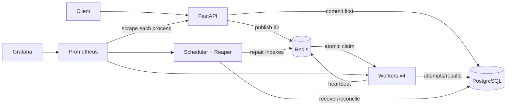
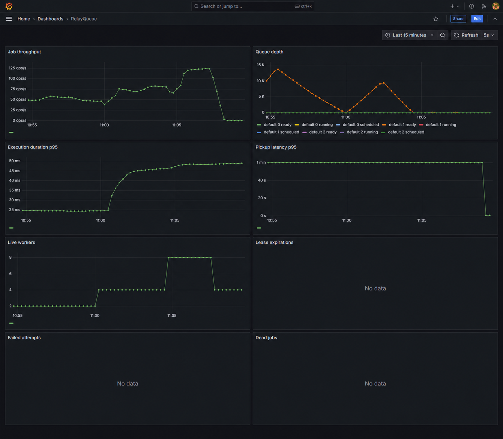
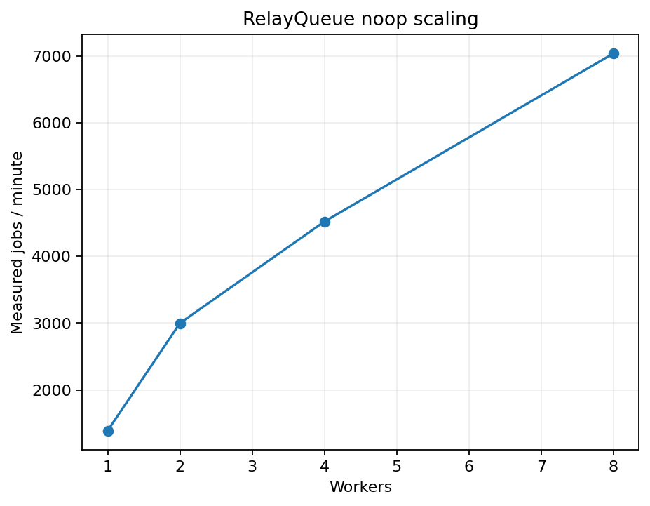
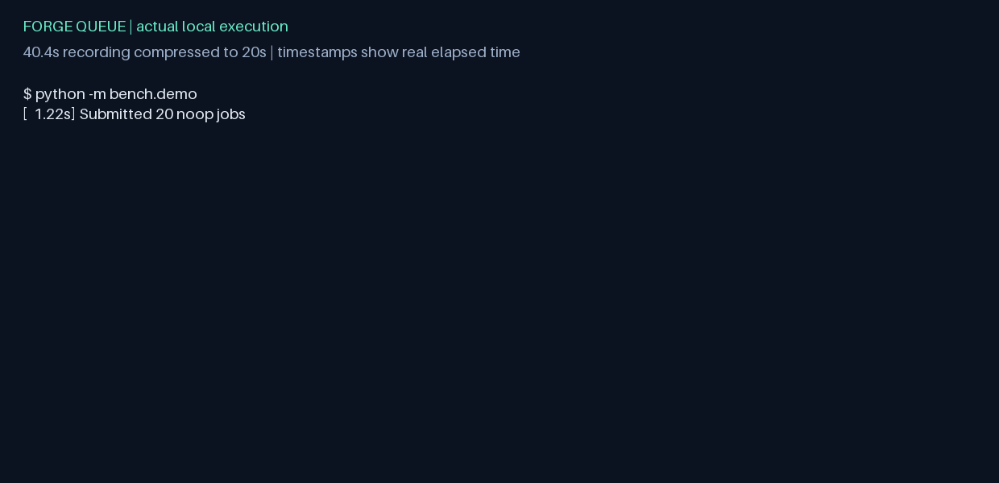

# RelayQueue

A distributed background job queue built from scratch in Python, with PostgreSQL durability,
atomic Redis leases, independent workers and recoverable execution history.

**Implementation and local validation delivered.** All 157 unit/integration tests pass with
89.93% coverage; Linux verification also passes. The final crash campaign completed 10,000 jobs
with zero lost jobs. Four workers process 4,521 noop jobs/min. **The sustained-rate latency target now passes: 35 ms p95 and 50 ms p99 at 100 RPS.** See the [engineering report](docs/final-report.md)
and [acceptance gates](docs/acceptance.md) for measurements, evidence and remaining work.

## 1. What problem this solves

An API should not hold a request open while performing expensive or failure-prone work. RelayQueue accepts a durable job, lets independent workers execute it, and handles the partial failures
between submission, claiming, processing and completion. The central engineering problem is
ownership and recovery when a process or dependency disappears.

## 2. Features

- Typed submissions, configured queue names, three priorities, delayed execution and idempotency keys.
- Atomic Lua claims, token-fenced attempts, heartbeat leases and worker registration.
- Persisted full-jitter retries, execution timeouts, dead-letter handling and manual reruns.
- Durable cancellation intent, graceful draining, lost-worker recovery and Redis reconstruction.
- Five handlers: `noop`, `sleep`, `flaky`, `cpu_hash`, `http_call`.
- Token-bucket admission control, cursor pagination, job history and worker/queue statistics.
- JSON logs, process-specific Prometheus metrics and an automatically provisioned Grafana dashboard.
- Alembic migrations, typed Python, unit/integration/chaos suites, CI and reproducible benchmarks.

## 3. Architecture



[Detailed ownership and lifecycle diagram](docs/architecture.md).

## 4. Technology stack

Python 3.12, FastAPI/Uvicorn, Pydantic v2, PostgreSQL 16, SQLAlchemy 2 async/asyncpg, Alembic,
Redis 7/redis-py/Lua, pydantic-settings, structlog and prometheus-client. Testing uses pytest,
pytest-asyncio, pytest-cov and real databases through testcontainers. Locust/custom Python drive
benchmarks. Ruff, strict mypy, Docker Compose, Prometheus, Grafana and GitHub Actions complete
the toolchain. No Celery, RQ, managed broker or other queue framework is used.

`uv.lock`, `requirements.txt` and `requirements-dev.txt` pin resolved dependencies. Docker installs
the production lock export. Regenerate exports whenever dependencies change.

## 5. Quick start

Prerequisites: Docker Engine or Docker Desktop running, with Compose v2. From this directory:

```sh
docker compose up -d --build
curl http://localhost:8000/ready
curl -X POST http://localhost:8000/v1/jobs -H "X-API-Key: dev-key-1" -H "Content-Type: application/json" -d '{"task":"noop"}'
```

Plain `docker compose up` also builds and starts the system. The migration service applies Alembic
before API/workers/reaper start. Four worker replicas run by default. No manual database setup
is required; this startup path has been verified locally.

API documentation: [localhost:8000/docs](http://localhost:8000/docs).
Grafana: [localhost:3000](http://localhost:3000), local-only login `admin` / the configured `GRAFANA_PASSWORD`.
Prometheus: [localhost:9090](http://localhost:9090). Published ports bind to 127.0.0.1.
Copy `.env.example` to `.env` for overrides. `docker compose down` keeps persistent volumes;
`docker compose down --volumes` intentionally removes demo data.

PowerShell submission and retrieval:

```powershell
$headers = @{ 'X-API-Key' = 'dev-key-1' }
$job = Invoke-RestMethod http://localhost:8000/v1/jobs -Method Post -Headers $headers -ContentType application/json -Body '{"task":"noop"}'
Invoke-RestMethod "http://localhost:8000/v1/jobs/$($job.id)" -Headers $headers
```

## 6. Job lifecycle

New jobs are queued or scheduled. A valid claim creates a running attempt. Success stores a JSON
result; failure becomes failed_retrying with a durable next execution time, or dead when attempts
are exhausted. Scheduler promotion returns retrying jobs to queued. Cancellation is terminal only
after it is safe to acknowledge. All state changes use `core/states.py`, with row locks around
durable decisions. A successful or cancelled job cannot transition back to running.

## 7. API reference

All `/v1` routes require `X-API-Key`. Errors have `code` and `message`; validation errors do not echo
payloads or secrets. Missing keys return 401. Unknown job IDs return 404.

| Method / path | Behavior |
|---|---|
| POST `/v1/jobs` | 201 for new jobs, 200 for an existing queue/idempotency key |
| GET `/v1/jobs/{id}` | Full job and ordered `history` of attempts |
| GET `/v1/jobs` | Filter by status, queue and task; newest-first cursor pagination |
| POST `/v1/jobs/{id}/cancel` | 202 accepted, 409 if already terminal |
| POST `/v1/jobs/{id}/retry` | 202 for a dead job, 409 otherwise |
| GET `/v1/queues/stats` | Counts by status/priority and oldest ready age |
| GET `/v1/workers` | Worker records, heartbeat, completed attempts and computed liveness |
| GET `/health` | Unauthenticated liveness |
| GET `/ready` | 200 if both stores respond; otherwise 503 |
| GET `/metrics` | Unauthenticated Prometheus exposition; intended for internal access |

`limit` is 1-100. Cursor ordering uses both creation timestamp and UUID, so timestamp ties do not
repeat rows. Invalid list arguments/cursors return 400. Unknown task/payload schema errors return
422, oversized payloads return 413, unconfigured queues return 400, and rate limiting returns
429 with `Retry-After: 1`. The default per-key bucket holds 200 tokens and refills at 200/second.

## 8. Example submissions and results

```sh
curl -X POST http://localhost:8000/v1/jobs -H "X-API-Key: dev-key-1" -H "Content-Type: application/json" -d '{"task":"sleep","payload":{"seconds":2},"priority":0,"timeout_s":10,"idempotency_key":"demo-sleep-1"}'
curl http://localhost:8000/v1/jobs/JOB_ID -H "X-API-Key: dev-key-1"
curl 'http://localhost:8000/v1/jobs?status=dead&limit=10' -H "X-API-Key: dev-key-1"
curl -X POST http://localhost:8000/v1/jobs/JOB_ID/retry -H "X-API-Key: dev-key-1"
```

Replace JOB_ID with the returned UUID. A completed sleep result is `{"slept":2.0}`. Add an
offset-aware ISO-8601 `run_at` for delayed execution. Payloads/results are limited to 65,536 UTF-8
serialized JSON bytes. Request metadata is separately bounded by a 512 KiB streaming body cap.

| Handler | Payload |
|---|---|
| noop | `{}` |
| sleep | `{"seconds":2}` |
| flaky | `{"fail_rate":0.5}` |
| cpu_hash | `{"buffer":"abc","iterations":10000}` |
| http_call | `{"url":"http://test-server:8080/","timeout_s":5}` |

HTTP calls require an exact origin in `HTTP_ALLOWED_ORIGINS`; default outbound HTTP is disabled.
Redirects and environment proxies are disabled. Tests use a local HTTP mock service.

## 9. Worker execution

Each independent process rotates through configured queues and runs WORKER_CONCURRENCY slots
(default 1). It claims via Lua, validates PostgreSQL, records an attempt, then executes without
holding a database lock. Idle polling backs off 50 ms to one second. Best-effort Redis pub/sub
wakeups reduce idle pickup latency; missed notifications fall back to polling. CPU hashing runs
in a killable subprocess. Async tasks are cancelled and awaited on timeout or cancellation.

Every tenth successful claim checks priorities low-to-high. This gives low-priority work progress
under high-priority load, trading strict high-priority precedence for bounded claim opportunity.
FIFO ordering within a priority uses the time that work became ready. Cross-queue scheduling
rotates; queue names must be configured in `QUEUES` to bound metrics cardinality and avoid silent
submission into a queue that no worker consumes.

## 10. Leases, heartbeat and shutdown

Defaults: 30-second lease, 10-second heartbeat, 5-second reaper, 1-second scheduler, 60-second
reconciliation. Heartbeat must be at most one-third of the lease. Redis TIME determines lease
deadlines. Heartbeat and release compare the full claim token atomically. PostgreSQL's current
token fences stale durable completions.

SIGTERM stops claims, marks draining and allows 30 seconds for active work. Grace expiry stops
handlers and records failure when possible. SIGKILL relies on lease expiry/reaper recovery.
Linux CPU children receive a parent-death signal; a watchdog bounds their lifetime elsewhere.

## 11. Retries and dead-letter queue

Handler errors and timeouts use persisted full jitter:

```python
random.uniform(0, min(300, 2 * 2 ** (attempt - 1)))
```

No worker sleeps through its retry delay. Defaults allow five attempts; API range is 1-20. Dead
jobs preserve payloads/errors/history. Manual retry resets the current retry count but retains a
monotonic lifetime attempt sequence. Expired leases consume an attempt and immediately requeue
when budget remains. This explicit exception reconciles the PRD's recovery target with its retry
delays; [design decisions](docs/design-decisions.md) explain the two validated state transitions.

## 12. Cancellation

Queued/scheduled/retrying jobs become cancelled in PostgreSQL before Redis cleanup. Any stray
claim is rejected against durable state. Running cancellation first records intent; 202 may
return `status=running, cancel_requested=true`. The next heartbeat stops the handler and records
terminal cancellation. Losing a Redis cancellation hint does not lose the durable request.
Previously performed external side effects cannot be undone.

## 13. Idempotency and delivery guarantees

Accepted means a job committed to PostgreSQL. Assuming durable database storage and eventual
service recovery, jobs stay discoverable and are retried or dead-lettered after failures. Execution
is at least once, never exactly once: a worker may finish an effect and die before committing its
result. PostgreSQL is the accounting authority; Redis and Prometheus are not substitutes.

The `core/effects.py` helper deduplicates database effects within the same transaction:

```python
async with runtime.sessions.begin() as session:
    result = await apply_once(session, "invoice:42", create_invoice_in_this_session)
```

The integration suite demonstrates concurrent duplicate callbacks and transaction rollback.
External HTTP/email effects need downstream idempotency or an appropriately designed outbox.
Run `docker compose exec api python -m relayqueue.examples.effect_ledger` to record the same
notification receipt twice with one durable ledger entry. This example records a receipt; it
does not send an email.

## 14. Crash recovery and Redis reconciliation

The reaper repairs committed-but-unpublished jobs, abandoned pre-database claims, expired running
attempts and stale terminal indexes. Startup performs a full reconciliation; periodic scans use
bounded UUID batches. Every mutation rereads current state under a row lock. Concurrent repair
cannot turn a live lease into a second valid claim. Running jobs without matching Redis ownership
are recovered even if Redis lost its entire lease index.

The failure-window table and remaining cross-store limitations are in
[design decisions](docs/design-decisions.md). Backups and recovery of PostgreSQL itself are outside
this local implementation's no-lost-job assumption.

## 15. Observability

Prometheus scrapes API metrics, every worker replica through DNS discovery, and the reaper.
The provisioned dashboard shows throughput, queue depth, p95 execution/pickup duration, workers,
lease expirations, failures and dead jobs. All nine PRD metric families are implemented. Worker
counters are not incorrectly inferred from the API process. Logs are JSON with available job,
worker, attempt, queue and task fields; payloads, keys and raw HTTP exceptions are not logged.

Run `python -m bench.monitoring` to verify actual targets and dashboard provisioning.



Captured after the final scaling workload on November 6; the visible history shows two,
four and eight workers, then the return to four. Failure-event panels have no samples in
this successful-workload window.

## 16. Tests and CI

```sh
python -m pip install -r requirements-dev.txt
python -m pip install --no-deps -e .
python -m pytest tests/unit -q
python -m pytest tests/unit tests/integration --cov=relayqueue --cov-fail-under=85
python -m ruff check src tests bench migrations
python -m mypy --strict src
```

Testcontainers tests include concurrent idempotency, 1,000 jobs with eight claimants, lease loss,
late results, cancellation, delayed jobs, Redis index loss, concurrent repair and cursor ties.
Chaos tests use real Docker processes. CI runs lint/types/unit/integration/coverage/image build;
nightly runs chaos, a short benchmark and monitoring checks. CI is configured, **not observed
green**. Repository URLs are unknown, so no invented CI badge or coverage-service badge appears.
Use [testing instructions](docs/testing.md) for exact commands and fixture safety.

## 17. Performance

| Experiment | Target | Observed result |
|---|---|---|
| P1: 20,000 noop jobs / four workers | >=1,000 jobs/min | PASS: 4,521.405 jobs/min; all succeeded |
| P2: 1/2/4/8 workers | Close to linear from 1 to 4 | PASS (measurement): 3.26x speedup, 81.4% of ideal; qualitative target has no tolerance |
| P3: 100 requests/s for 300 s | p95 <50 ms; p99 <100 ms | PASS: 100.000 RPS, p95 35 ms, p99 50 ms; zero failures (November 10) |
| P4: 100 idle samples | p95 <200 ms | PASS: p95 10.721 ms |
| P5: step load | Report first p95 >100 ms | PASS (measurement): already exceeded at 25 target RPS; threshold <=25 RPS |



Raw JSON/CSV records include machine and runtime fingerprints. See the
[engineering report](docs/final-report.md) and [reproduction commands](docs/testing.md).

## 18. Reliability experiments and demo

R1-R6 cover repeated SIGKILL, lease-to-ready recovery time, observed duplicate completions, Redis
restart/index loss, 50% flaky workloads and SIGTERM draining. All were executed on the final image:
10,000/10,000 crash-campaign jobs succeeded; maximum expiry-to-ready time was 2.995 seconds.
Redis recovery accounted for all 100 jobs within 31.36 seconds. Duplicate-completion telemetry
observed 0.01% and is explicitly a lower bound, not an exactly-once claim.

`python -m bench.record_demo` runs the real demo, verifies the killed owner's recovery history,
and records timestamped stdout. This run accounted for all 25 accepted jobs: 24 succeeded and
one deliberately failing job reached the dead-letter queue.



Actual 40.4-second execution compressed to a 20-second GIF; displayed timestamps are real.
The unedited event log is [demo-recording.json](bench/results/demo-recording.json).

## 19. Repository and engineering trade-offs

```text
src/relayqueue/
  api/       HTTP routes, auth, rate limiting, schemas
  core/      SQLAlchemy models, repository, state machine, effects, backoff
  broker/    Redis adapter and six Lua scripts
  worker/    execution loop, registry, handlers, isolated CPU child
  reaper/    scheduler, expiry recovery, reconciliation
  obs/       logging and metrics
migrations/  Alembic schema
tests/       unit, real-service integration, real-process chaos
bench/       throughput, scaling, latency, chaos, reliability, demo
deploy/      Dockerfile, Prometheus and Grafana provisioning
docs/        architecture, decisions, requirement matrix, evidence and acceptance
```

Correctness takes precedence over peak throughput: durable row locks, an independent completion
audit, and per-job reconciliation round trips cost latency. Redis cannot atomically commit with
PostgreSQL; reconciliation repairs gaps. At 10x load, batch publication and pool/query tuning are
likely necessary. At 100x, partition history and shard queues/ownership. See the detailed trade-offs
in [design decisions](docs/design-decisions.md).

## 20. Limitations and remaining acceptance work

The corrected sustained-rate P3 latency gate passes. Remote CI remains NOT RUN because no
GitHub repository is configured. Previous benchmark results remain historical evidence tied
to their source/image fingerprints; see the update below.

Other limits: one Redis server; no clustering, multi-region, workflow DAGs or tenant isolation;
no job/history retention policy; trusted configured HTTP origins; operational counters can lose
unscraped events on process death. External effects remain at least once. Recovery targets depend
on scan phase, load and service availability. Container tags can receive patch updates.
No production-readiness claim is made.


## RelayQueue update — November 10

The package, imports, entry points, API title and dashboard title now use RelayQueue/`relayqueue`.
Docker project/image/network identifiers and dashboard UID use `relayqueue`.
The renamed Compose project reuses existing named volumes to preserve stored data. Database tables and migration IDs are unchanged. Historical
charts and demo recordings are rendered from the original data with RelayQueue branding. The historical dashboard image was AI-edited for RelayQueue branding and is illustrative; use the raw benchmark results for exact measurements and source fingerprints.

The final 300-second corrected P3 run achieved 100.000 RPS, p95 35 ms, p99 50 ms, zero failures.
See [raw result](bench/results/latency-relayqueue-p3.json).
The earlier Locust pacing initialized its clock before startup jitter, cancelling that jitter
and synchronizing clients on later requests. The corrected per-client monotonic schedule keeps
phases spread, includes request time, and avoids catch-up bursts after overruns. Earlier 630 ms
P3 and P5 results describe burst-shaped load; they are retained, not relabeled as sustained tests.
The API also uses Uvicorn standard runtime dependencies and an async repository dependency.
No synchronous-commit, fsync, ownership or durability guarantees were weakened. Default API
process count remains two. The benchmark correction is the main observed improvement; the
35 ms result must not be represented as a 630-to-35 ms server-only optimization.

Remaining external gate: execute the configured workflow in a real GitHub repository.
