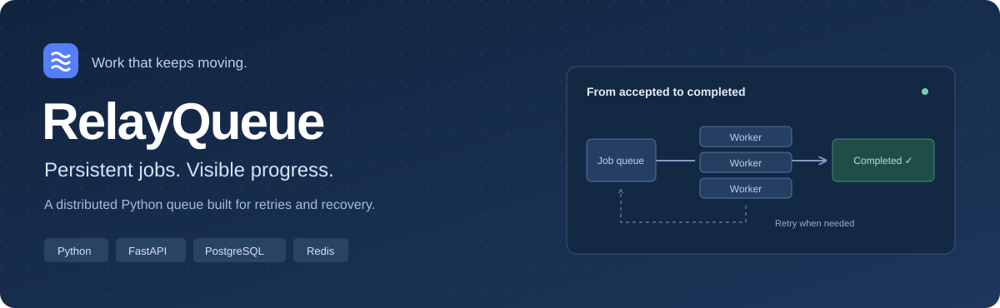
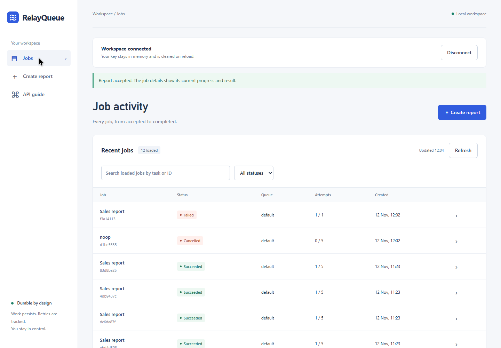
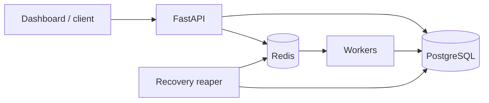

<p align="center">
  
</p>

<p align="center">
  <strong>Accept work in milliseconds. Track every attempt. Recover when workers fail.</strong>
</p>

<p align="center">
  <a href="#quick-start">Quick start</a> &nbsp; · &nbsp;
  <a href="#see-it-in-action">Dashboard</a> &nbsp; · &nbsp;
  <a href="#measured-not-guessed">Benchmarks</a> &nbsp; · &nbsp;
  <a href="docs/architecture/README.md">Architecture</a> &nbsp; · &nbsp;
  <a href="#go-deeper">Documentation</a>
</p>

---

RelayQueue turns API requests into durable background jobs. PostgreSQL owns the job lifecycle;
Redis coordinates leases; independent workers execute tasks. When a worker disappears, a reaper
recovers its abandoned work. The dashboard makes that lifecycle visible.

| Durable by default | Built to recover | Easy to inspect |
| :--- | :--- | :--- |
| Persisted jobs, results, and attempt history | Heartbeats, retries, and crash recovery | Searchable jobs and live status |
| Priorities, scheduled work, and submission deduplication | Dead-letter handling and cancellation | Result details, metrics, and Grafana |

## See it in action

<p align="center">
  <a href="output/playwright/dashboard-demo.webm">
    
  </a>
</p>

<p align="center">
  <a href="output/playwright/dashboard-demo.webm"><strong>Watch the recorded demo</strong></a> &nbsp; · &nbsp;
  <a href="output/playwright/dashboard-mobile.png">Mobile preview</a> &nbsp; · &nbsp;
  <a href="docs/sales-report.md">Explore the CSV workflow</a>
</p>

**Real input → background execution → inspectable result.** Upload a sales CSV to calculate
revenue and units by product. Follow its status, open its attempt history, and inspect the result.
The included sample returns **3 rows · 6 units · 50.10 revenue**.

## Quick start

With Docker running and Compose v2 installed, run from the repository root:

```sh
docker compose up -d --build --wait --wait-timeout 180
```

1. Open **[localhost:8000](http://localhost:8000/)**.
2. Select **Try local demo**, or connect with `dev-key-1`.
3. Open **Create report → Use sample data → Create report**.

The job details open immediately. Navigation stays in the same tab.

Prefer a terminal? Run the reproducible demo:

```sh
docker compose --profile demo run --rm demo
```

It checks the successful report, duplicate submissions, and an invalid file's retry/dead-letter history.

<details>
<summary><strong>Submit your first job with the API</strong></summary>

```sh
curl -X POST http://localhost:8000/v1/jobs \
  -H 'X-API-Key: dev-key-1' \
  -H 'Content-Type: application/json' \
  -d '{"task":"noop"}'

curl http://localhost:8000/v1/jobs/JOB_ID -H 'X-API-Key: dev-key-1'
```

Replace `JOB_ID` with the returned ID.

**PowerShell**

```powershell
$headers = @{ 'X-API-Key' = 'dev-key-1' }
$job = Invoke-RestMethod http://localhost:8000/v1/jobs -Method Post -Headers $headers -ContentType application/json -Body '{"task":"noop"}'
Invoke-RestMethod "http://localhost:8000/v1/jobs/$($job.id)" -Headers $headers
```

[Interactive API reference](http://localhost:8000/docs) · [Full API guide](docs/api/README.md)

</details>

<details>
<summary><strong>Local addresses and stopping the stack</strong></summary>

| Service | Address |
| --- | --- |
| Dashboard | [localhost:8000](http://localhost:8000/) |
| API readiness | [localhost:8000/ready](http://localhost:8000/ready) |
| API reference | [localhost:8000/docs](http://localhost:8000/docs) |
| Grafana | [localhost:3000](http://localhost:3000/) |
| Prometheus | [localhost:9090](http://localhost:9090/) |

```sh
docker compose down
```

This preserves data volumes. [Configuration and operating instructions](docs/operations/README.md).

</details>

## Under the hood



**PostgreSQL is authoritative.** Redis accelerates coordination and can be reconstructed.
Execution is **at least once**: handlers must tolerate replay, and external side effects can happen
twice. Submission deduplication does not promise exactly-once effects.

[Architecture and job states](docs/architecture/README.md) ·
[Tradeoffs, duplicate effects, and operating costs](docs/production-readiness.md)

## Measured, not guessed

| Experiment | Observed result | Evidence |
| :--- | :--- | :--- |
| Submission at 100 requests/s for 5 minutes | **35 ms p95**, 50 ms p99; zero failures | [Latency methodology](docs/benchmarks/README.md) |
| 20,000 noop jobs, four workers | **4,521 jobs/min** | [Benchmark report](docs/benchmarks/README.md) |
| 1,000 CSV jobs, 3 rows each | **2,249 jobs/min**; all results validated | [Raw results](bench/results/sales-3-rows.json) |
| 1,000 CSV jobs, 1,000 rows each | **1,899 jobs/min**; all results validated | [Raw results](bench/results/sales-1000-rows.json) |
| Worker crash campaign | **10,000 / 10,000 jobs succeeded** | [Recovery experiments](docs/benchmarks/README.md#reliability-experiments-and-demo) |

These are recorded local experiments, not production capacity guarantees. Workloads and test
conditions differ; the 35 ms submission result is **not** a CSV latency claim.
[Reproduce the CSV measurements](docs/local-rehearsal.md#measured-csv-workload).

## Verified locally

**184 tests passed · 88.60% coverage** in the November 12, 2026 validation run.

- Browser-tested uploads, search, pagination, retry, cancellation, and network-error recovery.
- Separate HTTPS rehearsal with queue-scoped tenant authorization and file-mounted secrets.
- Backup restored **374,075 jobs** and **374,213 attempts** into an isolated database.
- Monitoring delivered both firing and resolved alerts to the local receiver.

[Local setup and verification](docs/local-rehearsal.md) ·
[Restore evidence](bench/results/restore-verification.json)

> **Project status:** a working local demo and tested reference system. Public deployment still
> needs a host/domain, managed secrets, off-host backup scheduling, external alert delivery,
> and resource limits. Development credentials are for local use.

## Go deeper

| Guide | Start here when you want to… |
| :--- | :--- |
| [API](docs/api/README.md) | Submit work and inspect jobs programmatically |
| [Architecture](docs/architecture/README.md) | Understand leases, fencing, retries, and recovery |
| [CSV use case](docs/sales-report.md) | Process your own sales data |
| [Operations](docs/operations/README.md) | Configure, monitor, and develop the system |
| [Local HTTPS rehearsal](docs/local-rehearsal.md) | Try tenant isolation, retention, backups, and alerts |
| [Benchmarks](docs/benchmarks/README.md) | Inspect measurements and reproduce experiments |
| [Production boundaries](docs/production-readiness.md) | Evaluate tradeoffs and deployment requirements |

---

<p align="center"><sub>RelayQueue · Persistent jobs. Visible progress.</sub></p>
