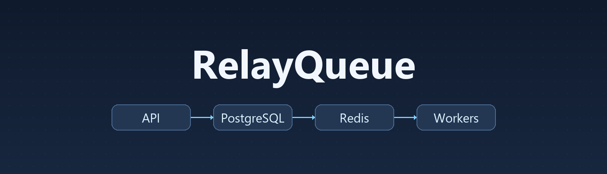

<p align="center">
  
</p>

<h1 align="center">RelayQueue</h1>

<p align="center">A distributed Python job queue with durable storage, leased workers, and crash recovery.</p>

<p align="center">
  <a href="#quick-start">Quick start</a> |
  <a href="docs/api/README.md">API</a> |
  <a href="docs/architecture/README.md">Architecture</a> |
  <a href="docs/operations/README.md">Operations</a> |
  <a href="docs/benchmarks/README.md">Benchmarks</a>
</p>

## Overview

RelayQueue lets an API accept work and return while independent workers handle execution. PostgreSQL stores jobs, results, and attempt history. Redis coordinates job claims and expiring leases, and a reaper recovers abandoned jobs and rebuilds missing Redis indexes.

- **Submit work** with priorities, delayed execution, and idempotency keys.
- **Handle failures** with heartbeats, persisted retries, cancellation, and a dead-letter queue.
- **Inspect the queue** through job history, worker and queue statistics, structured logs, and Grafana.

## Quick start

With Docker running and Compose v2 installed, start the stack from the repository root.

```sh
docker compose up -d --build --wait --wait-timeout 180
curl http://localhost:8000/ready
```

Once the API is ready, submit a job. Replace `JOB_ID` with the returned `id` to fetch its status, result, and attempt history.

```sh
curl -X POST http://localhost:8000/v1/jobs \
  -H 'X-API-Key: dev-key-1' \
  -H 'Content-Type: application/json' \
  -d '{"task":"noop"}'

curl http://localhost:8000/v1/jobs/JOB_ID -H 'X-API-Key: dev-key-1'
```

<details>
<summary>PowerShell example</summary>

```powershell
Invoke-RestMethod http://localhost:8000/ready
$headers = @{ 'X-API-Key' = 'dev-key-1' }
$job = Invoke-RestMethod http://localhost:8000/v1/jobs -Method Post -Headers $headers -ContentType application/json -Body '{"task":"noop"}'
Invoke-RestMethod "http://localhost:8000/v1/jobs/$($job.id)" -Headers $headers
```

</details>

[Open the interactive API docs](http://localhost:8000/docs) | [Configure or stop the local stack](docs/operations/README.md#local-services-and-configuration)

## Try a real file-processing workflow

Open the [local dashboard](http://localhost:8000/) and connect with `dev-key-1`.
[Dashboard demo, local HTTPS setup and CSV benchmarks](docs/local-rehearsal.md).

After starting the stack, run:

```sh
docker compose --profile demo run --rm demo
```

This submits a CSV sales export, follows job status and attempts, and returns exact revenue
totals. It verifies duplicate-submission handling and an invalid file's retries/dead-letter history.
The sample produces **3 rows, 6 units and 50.10 revenue**.

[Use your own CSV and inspect the guarantees](docs/sales-report.md) |
[Tradeoffs, duplicate effects and operating costs](docs/production-readiness.md)

## Measured results

| Workload | Observed result |
| --- | --- |
| Job submission at 100 requests/s for 5 minutes | 35 ms p95, 50 ms p99, zero request failures |
| 20,000 noop jobs on four workers | 4,521 jobs/min |
| Worker crash campaign | All 10,000 jobs succeeded |

[Benchmark methods, raw results, and recovery demo](docs/benchmarks/README.md)

## Documentation

| Guide | What you'll find |
| --- | --- |
| [API and job examples](docs/api/README.md) | Authentication, endpoints, payloads, and example requests |
| [Architecture and job execution](docs/architecture/README.md) | Job states, worker leases, retries, and recovery guarantees |
| [Operations and development](docs/operations/README.md) | Configuration, monitoring, tests, and repository layout |
| [Benchmarks and acceptance](docs/benchmarks/README.md) | Performance, reliability, the recovery demo, and acceptance status |
