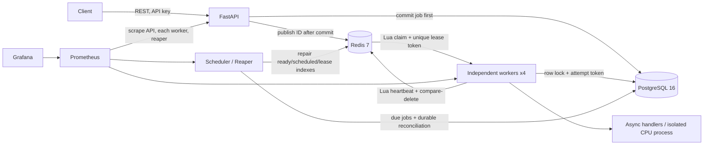
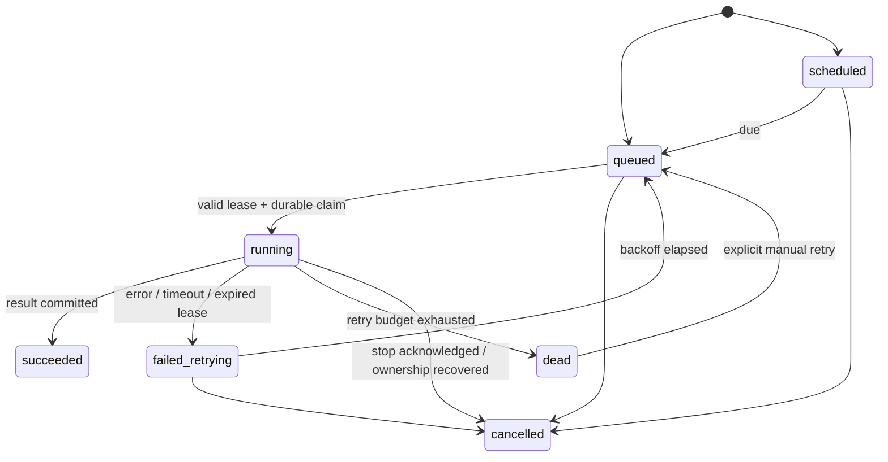

# Architecture and ownership

PostgreSQL owns definitions, lifecycle and attempts. Redis contains IDs, priority indexes,
scheduled timestamps, cancellation hints, liveness hints and lease tokens. There is no
cross-store transaction. All durable state decisions lock the job row, validate the central
transition graph, and use the current attempt token. Handler execution holds no database lock.

Workers discover configured queues in rotating order; claims within a queue prioritize 0, 1, 2.
Every tenth successful claim for a worker reverses this to 2, 1, 0. Redis owns this counter, so
concurrent slots cannot independently drift from the starvation guard. Empty polls do not count.

Each worker has its own metrics HTTP server on container port 9100. Prometheus DNS discovery
resolves all `worker` replicas, retaining one target per IP. The API serves its own metrics on
8000, and the reaper owns system gauges. The dashboard sums event counters across targets.
