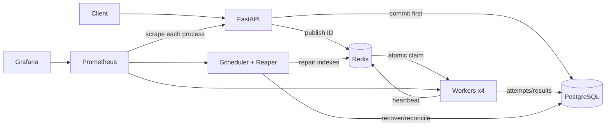

# Architecture and job execution

[RelayQueue](../../README.md) / Architecture and job execution

[Architecture](#architecture) | [Job lifecycle](#job-lifecycle) | [Worker execution](#worker-execution) | [Leases, heartbeat and shutdown](#leases-heartbeat-and-shutdown) | [Retries and dead-letter queue](#retries-and-dead-letter-queue) | [Cancellation](#cancellation) | [Idempotency and delivery guarantees](#idempotency-and-delivery-guarantees) | [Crash recovery and Redis reconciliation](#crash-recovery-and-redis-reconciliation)

## Architecture



[Detailed ownership and lifecycle diagram](../architecture.md).

## Job lifecycle

New jobs are queued or scheduled. A valid claim creates a running attempt. Success stores a JSON
result; failure becomes failed_retrying with a durable next execution time, or dead when attempts
are exhausted. Scheduler promotion returns retrying jobs to queued. Cancellation is terminal only
after it is safe to acknowledge. All state changes use `core/states.py`, with row locks around
durable decisions. A successful or cancelled job cannot transition back to running.

## Worker execution

Each independent process rotates through configured queues and runs WORKER_CONCURRENCY slots
(default 1). It claims via Lua, validates PostgreSQL, records an attempt, then executes without
holding a database lock. Idle polling backs off 50 ms to one second. Best-effort Redis pub/sub
wakeups reduce idle pickup latency; missed notifications fall back to polling. CPU hashing runs
in a killable subprocess. Async tasks are cancelled and awaited on timeout or cancellation.

Every tenth successful claim checks priorities low-to-high. This gives low-priority work progress
under high-priority load, trading strict high-priority precedence for bounded claim opportunity.
FIFO ordering within a priority uses the time that work became ready. Cross-queue scheduling
rotates; queue names must be configured in `QUEUES` to bound metrics cardinality and avoid silent
submission into a queue that no worker consumes.

## Leases, heartbeat and shutdown

Defaults: 30-second lease, 10-second heartbeat, 5-second reaper, 1-second scheduler, 60-second
reconciliation. Heartbeat must be at most one-third of the lease. Redis TIME determines lease
deadlines. Heartbeat and release compare the full claim token atomically. PostgreSQL's current
token fences stale durable completions.

SIGTERM stops claims, marks draining and allows 30 seconds for active work. Grace expiry stops
handlers and records failure when possible. SIGKILL relies on lease expiry/reaper recovery.
Linux CPU children receive a parent-death signal; a watchdog bounds their lifetime elsewhere.

## Retries and dead-letter queue

Handler errors and timeouts use persisted full jitter:

```python
random.uniform(0, min(300, 2 * 2 ** (attempt - 1)))
```

No worker sleeps through its retry delay. Defaults allow five attempts; API range is 1-20. Dead
jobs preserve payloads/errors/history. Manual retry resets the current retry count but retains a
monotonic lifetime attempt sequence. Expired leases consume an attempt and immediately requeue
when budget remains. This explicit exception reconciles the PRD's recovery target with its retry
delays; [design decisions](../design-decisions.md) explain the two validated state transitions.

## Cancellation

Queued/scheduled/retrying jobs become cancelled in PostgreSQL before Redis cleanup. Any stray
claim is rejected against durable state. Running cancellation first records intent; 202 may
return `status=running, cancel_requested=true`. The next heartbeat stops the handler and records
terminal cancellation. Losing a Redis cancellation hint does not lose the durable request.
Previously performed external side effects cannot be undone.

## Idempotency and delivery guarantees

Accepted means a job committed to PostgreSQL. Assuming durable database storage and eventual
service recovery, jobs stay discoverable and are retried or dead-lettered after failures. Execution
is at least once, never exactly once: a worker may finish an effect and die before committing its
result. PostgreSQL is the accounting authority; Redis and Prometheus are not substitutes.

The `core/effects.py` helper deduplicates database effects within the same transaction:

```python
async with runtime.sessions.begin() as session:
    result = await apply_once(session, "invoice:42", create_invoice_in_this_session)
```

The integration suite demonstrates concurrent duplicate callbacks and transaction rollback.
External HTTP/email effects need downstream idempotency or an appropriately designed outbox.
Run `docker compose exec api python -m relayqueue.examples.effect_ledger` to record the same
notification receipt twice with one durable ledger entry. This example records a receipt; it
does not send an email.

## Crash recovery and Redis reconciliation

The reaper repairs committed-but-unpublished jobs, abandoned pre-database claims, expired running
attempts and stale terminal indexes. Startup performs a full reconciliation; periodic scans use
bounded UUID batches. Every mutation rereads current state under a row lock. Concurrent repair
cannot turn a live lease into a second valid claim. Running jobs without matching Redis ownership
are recovered even if Redis lost its entire lease index.

The failure-window table and remaining cross-store limitations are in
[design decisions](../design-decisions.md). Backups and recovery of PostgreSQL itself are outside
this local implementation's no-lost-job assumption.
