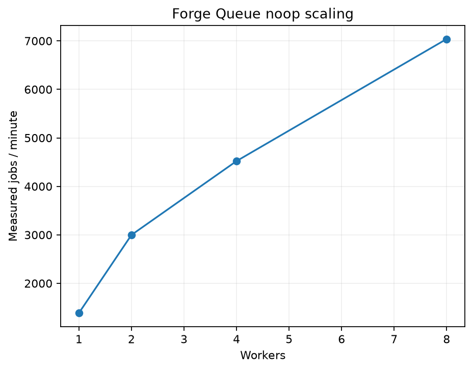
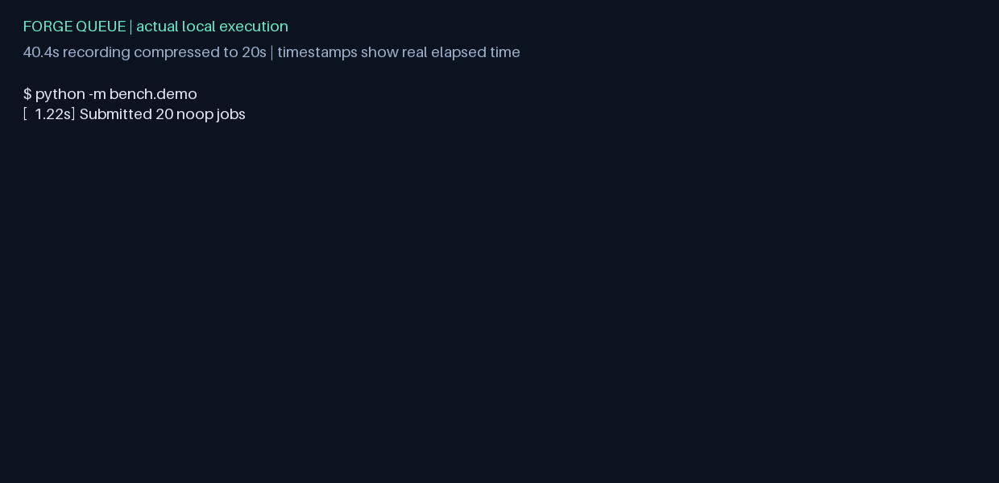

# Benchmarks and acceptance

[RelayQueue](../../README.md) / Benchmarks and acceptance

[Performance](#performance) | [CSV worker scaling](#csv-worker-scaling) | [Reliability experiments and demo](#reliability-experiments-and-demo) | [Verification](#verification) | [November 10 rename and latency retest](#november-10-rename-and-latency-retest)

## Performance

| Experiment | Target | Observed result |
|---|---|---|
| P1: 20,000 noop jobs / four workers | >=1,000 jobs/min | PASS: 4,521.405 jobs/min; all succeeded |
| P2: 1/2/4/8 workers | Close to linear from 1 to 4 | PASS (measurement): 3.26x speedup, 81.4% of ideal; qualitative target has no tolerance |
| P3: 100 requests/s for 300 s | p95 <50 ms; p99 <100 ms | PASS: 100.000 RPS, p95 35 ms, p99 50 ms; zero failures (November 10) |
| P4: 100 idle samples | p95 <200 ms | PASS: p95 10.721 ms |
| P5: step load | Report first p95 >100 ms | PASS (measurement): already exceeded at 25 target RPS; threshold <=25 RPS |



Raw JSON/CSV records include machine and runtime fingerprints. See the
[engineering report](../final-report.md) and [reproduction commands](../testing.md).

## CSV worker scaling

The November 22 local comparison ran two trials per worker count. Each trial submitted 1,000
sales reports with 1,000 rows each (16,024 bytes per file), using 16 concurrent HTTP submissions
and one execution slot per worker. All 6,000 reports succeeded on their first attempt and returned
the expected row, unit, and revenue totals.

| Workers | Jobs/min | Queue p95 | End-to-end p95 | Worker CPU | Worker memory | Raw trials |
| ---: | ---: | ---: | ---: | ---: | ---: | --- |
| 1 | 1,285–1,307 | 16.29–16.65 s | 16.30–16.68 s | 74–77% | 58–73 MiB | [1](../../bench/results/sales-scaling-1-1.json), [2](../../bench/results/sales-scaling-1-2.json) |
| 2 | 2,034–2,126 | 217–437 ms | 244–464 ms | 145–162% | 175–204 MiB | [1](../../bench/results/sales-scaling-2-1.json), [2](../../bench/results/sales-scaling-2-2.json) |
| 4 | 2,118–2,273 | 69–101 ms | 121–153 ms | 222% | 282–329 MiB | [1](../../bench/results/sales-scaling-4-1.json), [2](../../bench/results/sales-scaling-4-2.json) |

Ranges span the two trials. Queue latency is database creation to first claim. End-to-end
latency is database creation to durable completion. The wall-clock drain rate also includes
HTTP submission and polling. CPU is the mean of sampled service totals from `docker stats`
(100% is one logical CPU). Memory is the largest sampled total across that service's replicas.
The raw files include sample counts and API, PostgreSQL, Redis, reaper, and monitoring usage.

At one worker, submission finished after 27 s and the full drain took 46–47 s. Two workers
removed most of that backlog. Four reduced queue latency again, while the jobs/min ranges for
two and four overlapped. At two and four workers, 24–27.5 s of the 26–30 s drain was spent
submitting jobs. API and PostgreSQL mean CPU rose from 56–61% and 43–45% at two workers to
66–68% and 51–52% at four. The observed throughput includes the Windows client, HTTP admission,
and durable writes. This experiment did not profile those components in isolation.

The client ran on Windows 11 with Python 3.12.14 and 15.5 GiB of host RAM. Docker Desktop's Linux
engine (29.9.2) reported 18 logical CPUs and 7.5 GiB of RAM. The stack used two API processes,
single-node PostgreSQL and Redis, and the lease settings in the clean-install guide. The trial
order was 4, 2, 1 on the same disposable database, which accumulated completed jobs. A separate
local stack remained running on the same engine. These batch results describe this configuration
and load generator.

To repeat, start the [disposable stack](../getting-started.md#start-with-a-clean-clone), activate
its Python test environment, then run from the repository root. PowerShell uses
`New-Item -ItemType Directory -Force tmp` in place of `mkdir -p tmp`.

```sh
mkdir -p tmp
docker compose -p relayqueue-release-check up -d --wait --scale worker=2 worker
python -m bench.sales_workload --project relayqueue-release-check --workers 2 --jobs 1000 --rows 1000 --output tmp/sales-2-workers.json
```

Repeat at one and four workers with distinct output paths. The client waits for the expected
worker count and an empty pending queue before each run. Use `--rows 3` to run the small-file
workload. [Earlier small- and large-file runs](../local-rehearsal.md#measured-csv-workload).

## Reliability experiments and demo

R1-R6 cover repeated SIGKILL, lease-to-ready recovery time, observed duplicate completions, Redis
restart/index loss, 50% flaky workloads and SIGTERM draining. All were executed on the final image:
10,000/10,000 crash-campaign jobs succeeded; maximum expiry-to-ready time was 2.995 seconds.
Redis recovery accounted for all 100 jobs within 31.36 seconds. Duplicate-completion telemetry
observed 0.01% and is explicitly a lower bound, not an exactly-once claim.

`python -m bench.record_demo` runs the real demo, verifies the killed owner's recovery history,
and records timestamped stdout. This run accounted for all 25 accepted jobs: 24 succeeded and
one deliberately failing job reached the dead-letter queue.



Actual 40.4-second execution compressed to a 20-second GIF; displayed timestamps are real.
The unedited event log is [demo-recording.json](../../bench/results/demo-recording.json).

## Verification

| Evidence | Revision or environment | Observed result |
| --- | --- | --- |
| November 22 clean-checkout verification | Windows 11, Python 3.12.14, Docker Desktop, real PostgreSQL and Redis | 186 unit/integration tests passed, 88.48% branch-inclusive coverage. The dashboard browser suite and CSV demo passed. The checksum drill recorded lease expiry, requeue, a verified result, and a Prometheus counter increase. [Walkthrough](../getting-started.md) |
| November 13 GitHub CI | `d97ddfa` | Verification and browser jobs passed. [CI run](https://github.com/visweshdev/RelayQueue/actions/runs/43470890830) |
| November 11 sales workflow CI | `918a5b4` | Verification passed. [CI run](https://github.com/visweshdev/RelayQueue/actions/runs/42970911948) |
| November 11 nightly reliability | `c0efe99` | Nightly reliability passed. [Nightly run](https://github.com/visweshdev/RelayQueue/actions/runs/42969147032) |

The [release workflow](../../.github/workflows/release.yml) runs verification on the tag and
tests the packaged wheel and a fresh Compose deployment before publishing. The archived
acceptance results and the latency retest below retain their original source and image fingerprints.
Recovery timing depends on lease settings, scan phase, and load. Metrics can lose unscraped
events when a process exits. See the [deployment-readiness matrix](../production-readiness.md#deployment-readiness-matrix)
for protections available in each configuration.

## November 10 rename and latency retest

The package, imports, entry points, API title and dashboard title now use RelayQueue/`relayqueue`.
Docker project/image/network identifiers and dashboard UID use `relayqueue`.
See [Compose volume migration](../operations/README.md#compose-volume-migration) when upgrading an existing deployment.

Historical
charts and demo recordings are rendered from the original data with RelayQueue branding. The historical dashboard image was AI-edited for RelayQueue branding and is illustrative; use the raw benchmark results for exact measurements and source fingerprints.

The final 300-second corrected P3 run achieved 100.000 RPS, p95 35 ms, p99 50 ms, zero failures.
See [raw result](../../bench/results/latency-relayqueue-p3.json).
The earlier Locust pacing initialized its clock before startup jitter, cancelling that jitter
and synchronizing clients on later requests. The corrected per-client monotonic schedule keeps
phases spread, includes request time, and avoids catch-up bursts after overruns. Earlier 630 ms
P3 and P5 results describe burst-shaped load; they are retained, not relabeled as sustained tests.
The API also uses Uvicorn standard runtime dependencies and an async repository dependency.
No synchronous-commit, fsync, ownership or durability guarantees were weakened. Default API
process count remains two. The benchmark correction is the main observed improvement; the
35 ms result must not be represented as a 630-to-35 ms server-only optimization.

[Acceptance gates](../acceptance.md) | [PRD implementation matrix](../prd-implementation-matrix.md) | [Implementation progress](../implementation-progress.md)
