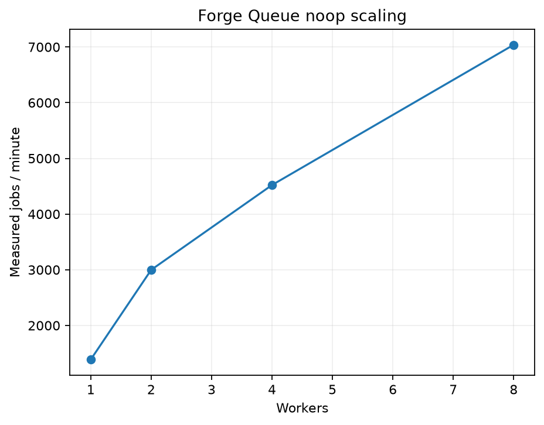
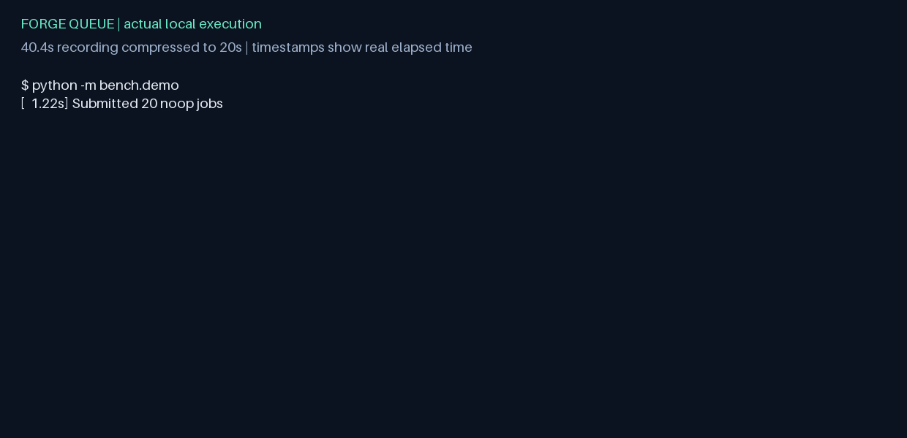

# Benchmarks and acceptance

[RelayQueue](../../README.md) / Benchmarks and acceptance

[Performance](#performance) | [Reliability experiments and demo](#reliability-experiments-and-demo) | [Limitations and remaining acceptance work](#limitations-and-remaining-acceptance-work) | [November 10 rename and latency retest](#november-10-rename-and-latency-retest)

## Performance

| Experiment | Target | Observed result |
|---|---|---|
| P1: 20,000 noop jobs / four workers | >=1,000 jobs/min | PASS: 4,521.405 jobs/min; all succeeded |
| P2: 1/2/4/8 workers | Close to linear from 1 to 4 | PASS (measurement): 3.26x speedup, 81.4% of ideal; qualitative target has no tolerance |
| P3: 100 requests/s for 300 s | p95 <50 ms; p99 <100 ms | PASS: 100.000 RPS, p95 35 ms, p99 50 ms; zero failures (November 10) |
| P4: 100 idle samples | p95 <200 ms | PASS: p95 10.721 ms |
| P5: step load | Report first p95 >100 ms | PASS (measurement): already exceeded at 25 target RPS; threshold <=25 RPS |

Raw JSON/CSV records include machine and runtime fingerprints. See the
[engineering report](../final-report.md) and [reproduction commands](../testing.md).

## Reliability experiments and demo

R1-R6 cover repeated SIGKILL, lease-to-ready recovery time, observed duplicate completions, Redis
restart/index loss, 50% flaky workloads and SIGTERM draining. All were executed on the final image:
10,000/10,000 crash-campaign jobs succeeded; maximum expiry-to-ready time was 2.995 seconds.
Redis recovery accounted for all 100 jobs within 31.36 seconds. Duplicate-completion telemetry
observed 0.01% and is explicitly a lower bound, not an exactly-once claim.

`python -m bench.record_demo` runs the real demo, verifies the killed owner's recovery history,
and records timestamped stdout. This run accounted for all 25 accepted jobs: 24 succeeded and
one deliberately failing job reached the dead-letter queue.

Actual 40.4-second execution compressed to a 20-second GIF; displayed timestamps are real.
The unedited event log is [demo-recording.json](../../bench/results/demo-recording.json).

## Limitations and remaining acceptance work

The corrected sustained-rate P3 latency gate passes. Remote CI remains NOT RUN because no
GitHub repository is configured. Previous benchmark results remain historical evidence tied
to their source/image fingerprints; see the [latency retest](#november-10-rename-and-latency-retest).

Other limits: one Redis server; no clustering, multi-region, workflow DAGs or tenant isolation;
no job/history retention policy; trusted configured HTTP origins; operational counters can lose
unscraped events on process death. External effects remain at least once. Recovery targets depend
on scan phase, load and service availability. Container tags can receive patch updates.
No production-readiness claim is made.

## November 10 rename and latency retest

The package, imports, entry points, API title and dashboard title now use RelayQueue/`relayqueue`.
Docker project/image/network identifiers and dashboard UID use `relayqueue`.
See [Compose volume migration](../operations/README.md#compose-volume-migration) when upgrading an existing deployment.

Historical
charts and demo recordings are rendered from the original data with RelayQueue branding. The historical dashboard image was AI-edited for RelayQueue branding and is illustrative; use the raw benchmark results for exact measurements and source fingerprints.

The final 300-second corrected P3 run achieved 100.000 RPS, p95 35 ms, p99 50 ms, zero failures.
See [raw result](../../bench/results/latency-relayqueue-p3.json).
The earlier Locust pacing initialized its clock before startup jitter, cancelling that jitter
and synchronizing clients on later requests. The corrected per-client monotonic schedule keeps
phases spread, includes request time, and avoids catch-up bursts after overruns. Earlier 630 ms
P3 and P5 results describe burst-shaped load; they are retained, not relabeled as sustained tests.
The API also uses Uvicorn standard runtime dependencies and an async repository dependency.
No synchronous-commit, fsync, ownership or durability guarantees were weakened. Default API
process count remains two. The benchmark correction is the main observed improvement; the
35 ms result must not be represented as a 630-to-35 ms server-only optimization.

GitHub CI and Nightly reliability passed on commit `c0efe99` on November 11, 2026. See [CI](https://github.com/visweshdev/RelayQueue/actions/runs/42969092458) and [Nightly](https://github.com/visweshdev/RelayQueue/actions/runs/42969147032).

[Acceptance gates](../acceptance.md) | [PRD implementation matrix](../prd-implementation-matrix.md) | [Implementation progress](../implementation-progress.md)
