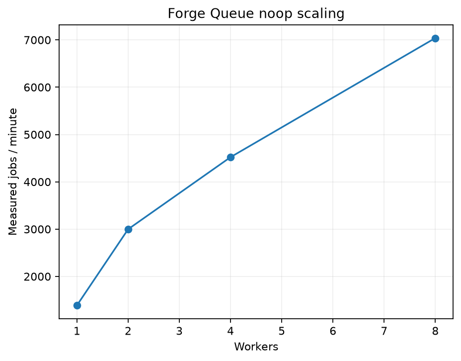

# RelayQueue engineering report

Evaluated 2026-11-06. Implementation and local validation are delivered. Full acceptance is
**not achieved**: P3 latency fails on this machine. Remote GitHub CI
is NOT RUN because this workspace has no Git repository/remote. No production-readiness claim.

## Implementation and repository

FastAPI commits accepted jobs to PostgreSQL before publishing Redis indexes. Independent workers
claim through Lua, validate durable ownership, execute typed handlers, and record fenced outcomes.
Independent scheduler, expiry recovery, reconciliation and metrics loops repair partial failures.

- `src/forgequeue/api`: authenticated routes, validation, rate limiting, cursors and metrics.
- `src/forgequeue/core`: durable state machine, models, repository, retries and effect ledger.
- `src/forgequeue/broker`: Redis adapter and six atomic Lua scripts.
- `src/forgequeue/worker`: handlers, bounded execution, heartbeat and graceful shutdown.
- `src/forgequeue/reaper`: scheduling, recovery, reconciliation and gauges.
- `migrations`, `deploy`, `compose.yaml`: schema, containers and monitoring provisioning.
- `tests`, `bench`, `.github/workflows`: tests, reproducible measurements and CI configuration.
- `docs`: architecture, design decisions, PRD matrix, acceptance and evidence.

Implemented features include priorities/starvation prevention, delayed jobs, idempotent submission,
full-jitter retries, dead-letter/manual rerun, cancellation, heartbeat leases, crash recovery,
Redis reconstruction, five typed handlers, durable attempt history, bounded HTTP calls, CPU
subprocess timeouts, JSON logs, Prometheus and an eight-panel Grafana dashboard.

## Tests and validation

Windows Python 3.12.14: **157 passed, zero skipped/failed**, 108.82 s, three dependency warnings;
**89.93% combined line/branch coverage**, with no source exclusions. This is 123 unit and
34 real PostgreSQL/Redis integration tests. Linux Python 3.12.16: 157 passed, 0 skipped, 108.84 s; combined coverage 90.28%.
Six additional process-chaos tests passed in 210.73 s after the recovery changes; those preceded
the two-process API change. R1-R6 above exercise the final image. Strict mypy checks 36 source
files. Ruff lint/format, package wheel, live/offline migrations, Compose startup and monitoring pass.
The local Linux test run validates the test portion of CI; it does not prove a remote workflow ran.

Reproduce static and test checks (Python 3.12, Docker running):

```sh
python -m pip install -r requirements-dev.txt
python -m pip install --no-deps -e .
python -m ruff check src tests bench migrations
python -m ruff format --check src tests bench migrations
python -m mypy --strict src
python -m pytest tests/unit tests/integration --cov=forgequeue --cov-fail-under=85
```

Set `REQUIRE_DOCKER=1` to fail rather than skip when Docker is unavailable. Set `RUN_CHAOS=1`
before `python -m pytest tests/chaos -v`. These fixtures use isolated disposable databases.

## Performance

| Experiment | Target | Observed result |
|---|---|---|
| P1: 20,000 noop jobs / four workers | >=1,000 jobs/min | PASS: 4,521.405 jobs/min; all succeeded |
| P2: 1/2/4/8 workers | Close to linear from 1 to 4 | PASS (measurement): 3.26x speedup, 81.4% of ideal; qualitative target has no tolerance |
| P3: 100 requests/s for 300 s | p95 <50 ms; p99 <100 ms | FAIL: 99.856 RPS, p95 630 ms, p99 910 ms; zero failures |
| P4: 100 idle samples | p95 <200 ms | PASS: p95 10.721 ms |
| P5: step load | Report first p95 >100 ms | PASS (measurement): already exceeded at 25 target RPS; threshold <=25 RPS |

| Workers | Jobs/min | Total seconds | Succeeded / missing |
|---|---|---|---|
| 1 | 1,388.554 | 864.208 | 20,000 / 0 |
| 2 | 2,998.214 | 400.238 | 20,000 / 0 |
| 4 | 4,521.405 | 265.404 | 20,000 / 0 |
| 8 | 7,039.263 | 170.472 | 20,000 / 0 |



P5 sixty-second steps: target/actual RPS = 25/24.669, 50/50.636, 150/144.600, 200/142.701;
p95 = 270, 290, 1300, 2600 ms; p99 = 2700, 320, 1800, 3400 ms. All had zero request failures.
No sub-25-RPS crossing was measured. P3 is a separate full five-minute run.

Environment: Intel Core Ultra 5 125H, 18 logical CPUs, 16.642 GB host RAM; Windows 11/WSL2,
Docker 29.9.2 with 18 CPUs/8.058 GB RAM. Linux Python 3.12.16 load generator shares the Compose
network; Windows orchestration uses Python 3.12.14. Four workers have one slot each; API has two
Uvicorn processes. Throughput includes submission/drain polling overhead. These are local,
single-machine measurements, not a distributed-host production capacity claim.

The first API process was a CPU bottleneck. Two API processes raised achieved P3 throughput
from about 78 to 100 RPS, but did not satisfy latency. Samples then showed API around 115%
CPU total, PostgreSQL around 80%, and significant worker CPU. Earlier database samples included
WALSync/WALWrite waits. These observations suggest per-job transaction/coordination and shared
host contention warrant profiling; they do not establish one definitive root cause. Durability
was not weakened to improve numbers. Earlier single-API data is preserved separately under
`bench/results/baseline-single-api/` and is not mixed into the final chart.

## Reliability

| Experiment | Result | Evidence |
|---|---|---|
| R1: repeated SIGKILL | PASS: 10,000 succeeded, zero missing/nonterminal | chaos.json; 120 s crash window, five-second cadence |
| R2: expiry to ready <5 s | PASS: maximum 2.9945 s over 21 observations | chaos.json |
| R3: measure duplicate executions | PASS (measurement): observed 0.01% | One audited completed attempt later expired; lower bound only |
| R4: Redis restart/rebuild <60 s | PASS: 100 succeeded, zero missing; 31.360 s | reliability-redis.json; includes forced index loss and drain |
| R5: 50% flaky workload terminates | PASS: 96 succeeded, four dead; zero missing | reliability-retry.json |
| R6: graceful shutdown | PASS: 100 succeeded; no stranded running rows | reliability-graceful.json |

Delivery remains at least once. Death after an external effect but before its durable audit is
invisible to R3, so 0.01% is a lower bound, not a complete duplicate-execution rate. R2 timing
compares Redis and PostgreSQL clocks and assumes synchronization. Recovery bounds depend on load.

## Engineering decisions

PostgreSQL is the accounting authority; Redis indexes are rebuildable. Unique claim tokens and
row locks fence stale results, while Lua makes Redis claims/renewals/releases atomic. There is
no cross-store transaction; reconciliation repairs gaps. Handler retry delays are persisted full
jitter. Expired leases immediately requeue within retry budget. Every tenth claim gives low
priority work an opportunity. Ready notifications supplement polling. CPU work is killable.
Two API processes aggregate counters through a fresh per-start Prometheus multiprocess directory.
Independent reaper loops prevent a long reconciliation from delaying lease recovery/scheduling.

## How to run

```powershell
docker compose up -d --build
Invoke-RestMethod http://localhost:8000/ready
$headers = @{ 'X-API-Key' = 'dev-key-1' }
$job = Invoke-RestMethod http://localhost:8000/v1/jobs -Method Post -Headers $headers -ContentType application/json -Body '{"task":"noop"}'
Invoke-RestMethod "http://localhost:8000/v1/jobs/$($job.id)" -Headers $headers
docker build -f deploy/Dockerfile.bench -t forgequeue-bench:local .
python -m bench.acceptance --resume
```

Use `.venv\Scripts\python.exe` if the default Python is not 3.12. On this host prepend
`$env:LOCALAPPDATA\Programs\DockerDesktop\resources\bin` to PATH for Docker.
[API docs](http://localhost:8000/docs), [Grafana](http://localhost:3000/d/forgequeue/forge-queue)
(local login `admin` / `forgequeue-local`), [Prometheus](http://localhost:9090).
The campaign can take around an hour and intentionally disrupts this local demo stack.

## Deliverables and remaining work

[Real 20-second demo GIF](../bench/results/demo.gif) and its
[timestamped event log](../bench/results/demo-recording.json) account for 25 jobs: 24 succeeded,
one deliberately dead. The killed owner's history confirms lease expiry then successful retry.
[Actual Grafana screenshot](../output/playwright/grafana.png), measured scaling chart, raw JSON,
Locust CSV and source/image fingerprints are included. The refreshed November 6 screenshot shows
the scaling history and return to four workers. Failure-event panels have no samples during
that successful-workload window.

Remaining acceptance work is explicit: profile end-to-end submit transactions/connection pools,
reduce safe coordination/query overhead, rerun P3 and 1-to-4-worker P2, and execute the configured
CI in a real GitHub repository. No remote was invented or published. There is no job retention
policy, Redis clustering, multiregion operation or tenant isolation. External effects require
downstream idempotency; operational metrics may lose unscraped events on crashes. PostgreSQL
backup/restore operations and deployment-specific production security are outside this local build.

Final runtime source SHA256: `4576bdd376a2bc9d9d9ba4ad0d075263ae5a146a0729c0e9cbbb049944d220cf`.
Image: `sha256:802e9d4ccbf6de78d5ea6538e7351e9f54d91d63679a62b82057db9a641b80b7`.
