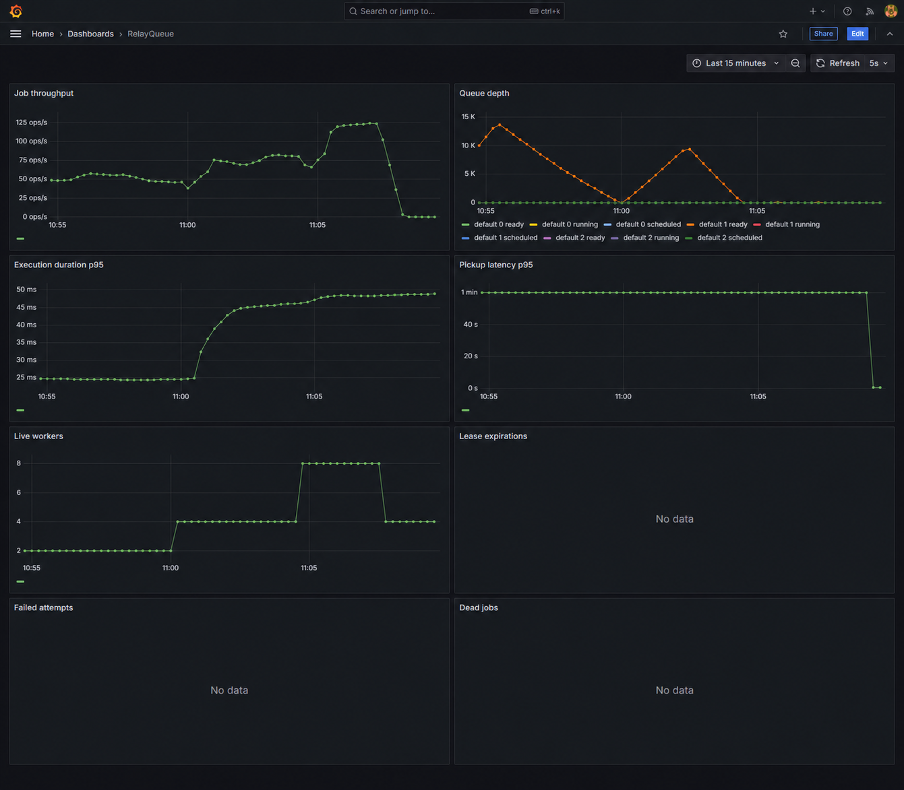

# Operations and development

[RelayQueue](../../README.md) / Operations and development

[Local services and configuration](#local-services-and-configuration) | [Compose volume migration](#compose-volume-migration) | [Technology stack](#technology-stack) | [Observability](#observability) | [Tests and CI](#tests-and-ci) | [Repository and engineering trade-offs](#repository-and-engineering-trade-offs)

## Local services and configuration

[Start the stack and submit your first job](../../README.md#quick-start).

Plain `docker compose up` also builds and starts the system. The migration service applies Alembic
before API/workers/reaper start. Four worker replicas run by default. No manual database setup
is required; this startup path has been verified locally.

API documentation: [localhost:8000/docs](http://localhost:8000/docs).
Grafana: [localhost:3000](http://localhost:3000), local-only login `admin` / the configured `GRAFANA_PASSWORD`.
Prometheus: [localhost:9090](http://localhost:9090). Published ports bind to 127.0.0.1.
Copy `.env.example` to `.env` for overrides. `docker compose down` keeps persistent volumes;
`docker compose down --volumes` intentionally removes demo data.

## Compose volume migration

The local deployment was migrated on November 11, 2026, with all 372,073 pre-existing jobs
preserved. PostgreSQL, Redis and Grafana now mount `relayqueue_*` volumes. Original volumes
remain offline rollback copies; they consume disk and are not kept synchronized with new writes.
Database tables and migration IDs are unchanged.

For another existing installation, first record its actual mounts with `docker inspect`, stop
producers and the Compose stack, and back up its volumes. Copy data only while the stores are
stopped, preserving file ownership, into empty destination volumes. Never overwrite a populated
destination. Start the renamed stack, compare job counts and attempt history, then verify
readiness and `python -m bench.monitoring` before accepting traffic. Fresh clones need no migration.

Grafana's initial password environment variable does not reset a password stored in an existing
database. To align this local demo's password explicitly:

```sh
docker compose exec grafana grafana cli --homepath /usr/share/grafana admin reset-admin-password relayqueue-local
```

For a persisted dashboard UID change, back up the stopped Grafana database and migrate the
existing dashboard record before reprovisioning. The local migration retained a SQLite backup
inside its Grafana volume. Do not delete the original storage until your backup and restore
procedure has been validated. For rollback after new jobs are accepted, reconcile those new
writes first; simply pointing at an old volume would hide them.

## Technology stack

Python 3.12, FastAPI/Uvicorn, Pydantic v2, PostgreSQL 16, SQLAlchemy 2 async/asyncpg, Alembic,
Redis 7/redis-py/Lua, pydantic-settings, structlog and prometheus-client. Testing uses pytest,
pytest-asyncio, pytest-cov and real databases through testcontainers. Locust/custom Python drive
benchmarks. Ruff, strict mypy, Docker Compose, Prometheus, Grafana and GitHub Actions complete
the toolchain. No Celery, RQ, managed broker or other queue framework is used.

`uv.lock`, `requirements.txt` and `requirements-dev.txt` pin resolved dependencies. Docker installs
the production lock export. Regenerate exports whenever dependencies change.

## Observability

Prometheus scrapes API metrics, every worker replica through DNS discovery, and the reaper.
The provisioned dashboard shows throughput, queue depth, p95 execution/pickup duration, workers,
lease expirations, failures and dead jobs. All nine PRD metric families are implemented. Worker
counters are not incorrectly inferred from the API process. Logs are JSON with available job,
worker, attempt, queue and task fields; payloads, keys and raw HTTP exceptions are not logged.

Run `python -m bench.monitoring` to verify actual targets and dashboard provisioning.



Captured after the final scaling workload on November 6; the visible history shows two,
four and eight workers, then the return to four. Failure-event panels have no samples in
this successful-workload window.

## Tests and CI

```sh
python -m pip install -r requirements-dev.txt
python -m pip install --no-deps -e .
python -m pytest tests/unit -q
python -m pytest tests/unit tests/integration --cov=relayqueue --cov-fail-under=85
python -m ruff check src tests bench migrations
python -m mypy --strict src
```

Testcontainers tests include concurrent idempotency, 1,000 jobs with eight claimants, lease loss,
late results, cancellation, delayed jobs, Redis index loss, concurrent repair and cursor ties.
Chaos tests use real Docker processes. CI runs lint/types/unit/integration/coverage/image build;
nightly runs chaos, a short benchmark and monitoring checks. CI and Nightly reliability passed on commit `c0efe99` on November 11, 2026.
See [workflow runs](https://github.com/visweshdev/RelayQueue/actions).
Use [testing instructions](../testing.md) for exact commands and fixture safety.
See [current delivery verification](../release-verification.md) and
[production boundaries and operating costs](../production-readiness.md).

## Repository and engineering trade-offs

```text
src/relayqueue/
  api/       HTTP routes, auth, rate limiting, schemas
  core/      SQLAlchemy models, repository, state machine, effects, backoff
  broker/    Redis adapter and six Lua scripts
  worker/    execution loop, registry, handlers, isolated CPU child
  reaper/    scheduler, expiry recovery, reconciliation
  obs/       logging and metrics
migrations/  Alembic schema
tests/       unit, real-service integration, real-process chaos
bench/       throughput, scaling, latency, chaos, reliability, demo
deploy/      Dockerfile, Prometheus and Grafana provisioning
docs/        architecture, decisions, requirement matrix, evidence and acceptance
```

Correctness takes precedence over peak throughput: durable row locks, an independent completion
audit, and per-job reconciliation round trips cost latency. Redis cannot atomically commit with
PostgreSQL; reconciliation repairs gaps. At 10x load, batch publication and pool/query tuning are
likely necessary. At 100x, partition history and shard queues/ownership. See the detailed trade-offs
in [design decisions](../design-decisions.md).
